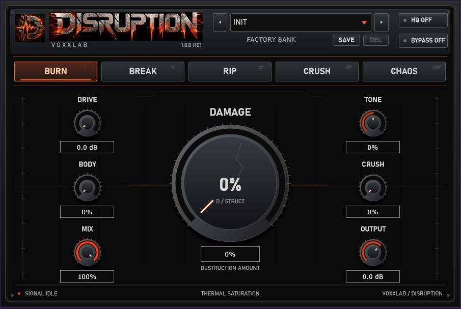

# DISRUPTION

Windows VST3 distortion effect with five processing engines, factory presets, and adjustable oversampling, built with JUCE.

## Overview

**DISRUPTION 1.0.0** is a Windows x64 VST3 audio destruction effect with five engines: BURN, BREAK, RIP, CRUSH and CHAOS.

[Download the Windows installer](https://github.com/scryingorb/DISRUPTION/releases/tag/v1.0.0)

## Features

- Choose BURN, BREAK, RIP, CRUSH, or CHAOS processing.
- Shape drive, damage, tone, body, bit crushing, mix, and output.
- Enable HQ oversampling for applicable engines.
- Load INIT and 30 factory presets or save user presets.
- Restore parameters in DAW sessions with matched mono/stereo support.

## Screenshots



Existing RC1 editor capture; the released editor displays 1.0.0.

## Technologies

C++17, JUCE 8.0.12, VST3, CMake, MSVC, and Inno Setup.

## Getting Started

Download the [Windows x64 version 1.0.0 release](https://github.com/scryingorb/DISRUPTION/releases/tag/v1.0.0). Close your DAW, run `DISRUPTION-1.0.0-Windows-x64-Setup.exe`, then rescan VST3 effects in your host. The installer places the whole plugin bundle in `C:\Program Files\Common Files\VST3\DISRUPTION.vst3`. In FL Studio, use Options > File settings > Manage plugins > Find installed plugins with Verify plugins enabled.

A portable ZIP is also provided: copy its whole DISRUPTION.vst3 directory into the same VST3 folder. Uninstall through Windows Installed apps. User presets in `%APPDATA%\VoxxLab\DISRUPTION\Presets` are preserved.

### Build or run from source

Requires CMake 3.22+, MSVC C++ build tools and Windows SDK. JUCE 8.0.12 is fetched automatically, or specify a local checkout:

```powershell
cmake -S . -B build -A x64 -DDISRUPTION_BUILD_TESTS=OFF
cmake --build build --config Release --target DISRUPTION_VST3 --parallel 2
```

The full historical test suite additionally requires archived Phase 1-7 VST3 baselines from development; they are not bundled with source. Production DSP, factory values, parameter IDs, state compatibility and plugin identity remain unchanged from the validated candidate.

[Release notes](CHANGELOG.md) | [Installation](INSTALLATION.md) | [Third-party JUCE notice](ThirdPartyLicenses/JUCE-LICENSE.md)

## Usage

DRIVE, DAMAGE, TONE, BODY, global CRUSH, MIX and OUTPUT shape the sound. HQ enables 4x oversampling where appropriate; CRUSH retains native-rate degradation. BYPASS preserves timing. All paths report 60 samples latency. Supports matched mono/stereo buses and a fixed 900 x 600 editor. Shift-drag adjusts finely; double-click resets knobs.

INIT + 30 factory presets are embedded. User preset save/load and independent DAW session recall are included. Extreme settings can exceed full scale; adjust Output for the signal chain.

The supplied screenshot shows the RC1 preview of this interface; the release editor displays 1.0.0. The user confirmed completion of manual QA before authorizing this release. Automated Phase 8 validation passed 350,132,333 checks, with zero tracked callback allocations and an exact Phase 7 audio match; see [QA report](Docs/Phase8-Report.md) for methodology and limits. Historical reports describe candidate-stage gates at the time they were written.

## Project Status

Released: version 1.0.0. See the retained QA notes for the scope of automated and manual validation.
